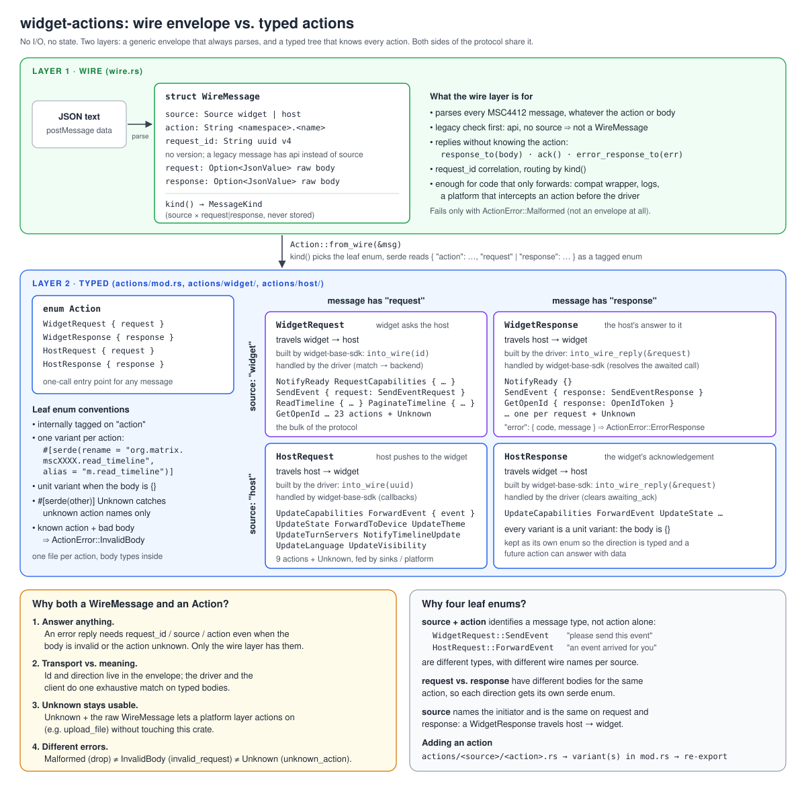
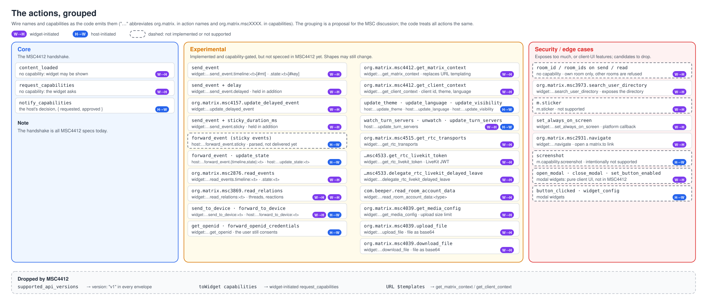

# matrix-widget-actions

**Responsibility:** the vocabulary of the widget API (MSC4412).
 - turns JSON into typed messages and back
 - parses capability strings
 - No I/O, no state, no policy
The widget side (`matrix-widget-sdk`) and the host side (`matrix-widget-host-driver`, `matrix-widget-host-backend-interface`)
both build on it.

It contains:

* `WireMessage`: the generic envelope (`source`, `action`, `request_id`, `request` /
  `response`). It parses any MSC4412 message, including unknown actions. Legacy messages (`api`
  instead of `source`) do not parse.
* `WidgetError` / `ErrorKind`: the error body `{ error: { code, message } }` and MSC4412's codes
  (`unknown_action`, `missing_capability`, `invalid_request`, `unknown`), plus
  `matrix_api_error` for failed Matrix requests and `event_not_cached` for a `read_timeline` whose
  `from` the client does not cache (both in the placeholder namespace).
* `Action` and its four leaf enums `WidgetRequest`, `WidgetResponse`, `HostRequest`,
  `HostResponse`: one variant per action, one file per action under `src/actions/`.
* `Capability` / `CapabilitySet`: capability strings and the `allows_*` checks. A capability
  embeds the wire name of its action (`widget:org.matrix.msc3869.read_relations:<type>`); the
  stable `m.` spelling is parsed as well. `capability_is_known` (exported to the bindings) tells
  them from strings outside the scheme (`Capability::Other`). The source `webview` is about no
  action: `WebviewSandbox` / `WebviewAllow` are one token of the widget iframe's `sandbox` or
  `allow` attribute (`webview:org.matrix.mscXXXX.allow:camera`, `is_webview`); a value that is no
  single web token (`is_webview_value`) is `Other`.
* `MatrixEvent`, `WidgetError` and the other shared payload types.



## How to use it

```rust
use matrix_widget_actions::{Action, Capability, CapabilitySet, WidgetRequest, WireMessage, WidgetError};

// incoming JSON → envelope → typed action
let msg = WireMessage::from_json(&json)?;              // Err for legacy messages (`api`, no `source`)
match Action::from_wire(&msg)? {
    Action::WidgetRequest { request: WidgetRequest::SendEvent { request } } => { /* … */ }
    Action::WidgetRequest { request: WidgetRequest::Unknown } => {
        let reply = msg.error_response_to(WidgetError::unknown_action(&msg.action));
    }
    _ => {}
}

// typed action → envelope → JSON
let out = WidgetRequest::NotifyReady.into_wire(uuid).to_json();
let ack = msg.ack();                                  // `{}` reply to any request

// capabilities
let approved = vec![Capability::parse("widget:org.matrix.mscXXXX.send_event.timeline:m.room.message")];
assert!(approved.allows_send("m.room.message", None, Some("m.text")));
```

To add an action, create `src/actions/<widget|host>/<action>.rs` with its body types, add a
variant with `#[serde(rename = "<wire name>")]` to the enums in that folder's `mod.rs`, and
re-export the body types from `lib.rs`.

Enable the `uniffi` feature to export all types to Kotlin / Swift / Python / TypeScript (via
`matrix-widget-host-driver`).

## All supported actions
Currently the actions crate supports the following actions:


### More diagrams

* [How the envelope changed from matrix-widget-api](../../docs/diagrams/03-wire-format-changes.svg)
* [Capabilities and how the actions use them](../../docs/diagrams/06-capabilities.svg)
