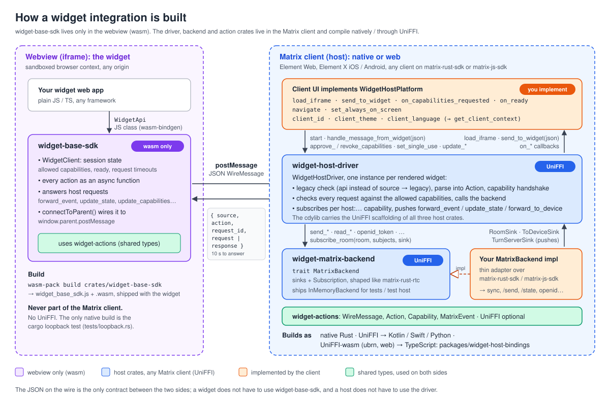
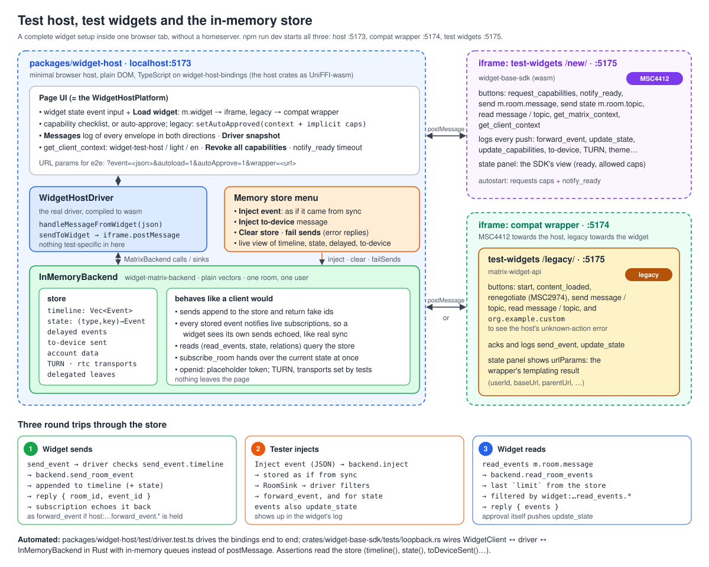

# matrix-widget-host-backend-interface

**Responsibility:** the boundary between the widget driver and a real Matrix SDK. It defines
the `MatrixBackend` trait, everything the driver needs from Matrix (send, read, subscribe,
OpenID, TURN, …). The trait is implemented by the client, once per Matrix SDK. It contains no
widget logic and no permission checks; the driver does those before it calls the backend.

One backend instance serves **one room**, the room the widget lives in. The trait is shaped like
matrix-rust-rtc's `MatrixBackend`, so one adapter can serve both (see `docs/parity.md`).



## How to use it

Implement the trait as a thin adapter over your SDK:

```rust
use std::sync::Arc;
use matrix_widget_host_backend_interface::{BackendError, JsonValue, MatrixBackend, RoomSink, RoomSubjects, Subscription};

struct MySdkBackend { room: matrix_sdk::Room }

#[async_trait::async_trait]
impl MatrixBackend for MySdkBackend {
    fn room_id(&self) -> String { self.room.room_id().to_string() }
    async fn send_room_event(&self, room_id: String, event_type: String, content: JsonValue)
        -> Result<String, BackendError> { /* room.send_raw(…) → event id */ }
    // timeline_read, timeline_paginate_backwards, subscribe_timeline, openid_token, …

    // The one method with substance: register listeners for the requested event types,
    // hand the sink the current state of every requested state type right away, forward new
    // timeline events, and return a Subscription whose cancel() removes the listeners.
    fn subscribe_room(&self, room_id: String, subjects: RoomSubjects, sink: Arc<dyn RoomSink>)
        -> Result<Arc<dyn Subscription>, BackendError> { /* … */ }
}
```

Errors are `BackendError::Failed { errcode, status, reason }`; the driver forwards `errcode`
and `status` to the widget as `matrix_api_error`. `timeline_read` answers a `from` it does not
cache with `BackendError::EventNotCached { event_id }`, which the widget gets as
`…event_not_cached`.

With the `uniffi` feature the trait can be implemented in Kotlin / Swift / Python / TypeScript.

## InMemoryBackend

A complete implementation over plain vectors, for tests and the browser test host:

```rust
let backend = InMemoryBackend::new("!room:example.org".into(), "@alice:example.org".into());
backend.inject(event);                 // as if it arrived from sync; notifies subscriptions
backend.fail_sends(Some("boom".into()));
let sent = backend.timeline();         // what the widget sent; also the timeline cache of `timeline_read`
// A widget's `paginate_timeline` stays pending until the test resolves it:
if let Some(pending) = backend.pending_pagination() { /* pending.limit: the widget's hint */ }
backend.resolve_pagination(older_events, /* start_reached */ false); // or fail_pagination(..), reset_timeline()
```


