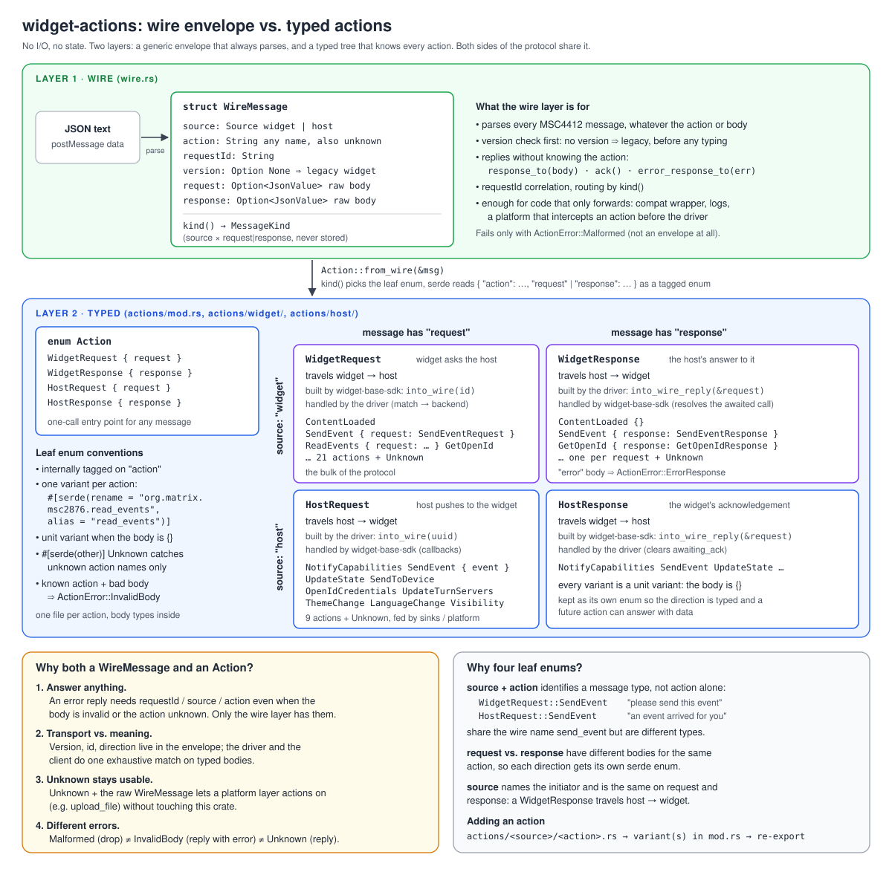
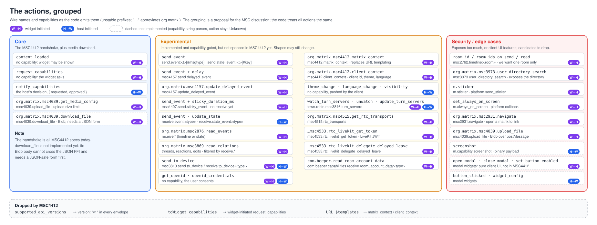

# widget-actions

**Responsibility:** the vocabulary of the widget API (MSC4412).
 - turns JSON into typed messages and back
 - parses capability strings
 - No I/O, no state, no policy
The widget side (`widget-base-sdk`) and the host side (`widget-host-driver`, `widget-matrix-backend`)
both build on it.

It contains:

* `WireMessage`: the generic envelope (`source`, `action`, `requestId`, `version`,
  `request` / `response`). It parses any MSC4412 message, including unknown actions.
* `Action` and its four leaf enums `WidgetRequest`, `WidgetResponse`, `HostRequest`,
  `HostResponse`: one variant per action, one file per action under `src/actions/`.
* `Capability` / `CapabilitySet`: capability strings and the `allows_*` checks.
* `MatrixEvent`, `WidgetError` and the other shared payload types.



## How to use it

```rust
use widget_actions::{Action, Capability, CapabilitySet, WidgetRequest, WireMessage, WidgetError};

// incoming JSON → envelope → typed action
let msg = WireMessage::from_json(&json)?;
if !msg.is_v1() { /* legacy widget */ }
match Action::from_wire(&msg)? {
    Action::WidgetRequest { request: WidgetRequest::SendEvent { request } } => { /* … */ }
    Action::WidgetRequest { request: WidgetRequest::Unknown } => {
        let reply = msg.error_response_to(WidgetError::new(format!("Unknown action {}", msg.action)));
    }
    _ => {}
}

// typed action → envelope → JSON
let out = WidgetRequest::ContentLoaded.into_wire(uuid).to_json();
let ack = msg.ack();                                  // `{}` reply to any request

// capabilities
let approved = vec![Capability::parse("org.matrix.msc2762.send.event:m.room.message")];
assert!(approved.allows_send("m.room.message", None, Some("m.text")));
```

To add an action, create `src/actions/<widget|host>/<action>.rs` with its body types, add a
variant with `#[serde(rename = "<wire name>")]` to the enums in that folder's `mod.rs`, and
re-export the body types from `lib.rs`.

Enable the `uniffi` feature to export all types to Kotlin / Swift / Python / TypeScript (via
`widget-host-driver`).

## All supported actions
Currently the actions crate supports the following actions:


### More diagrams

* [How the envelope changed from matrix-widget-api](../../docs/diagrams/03-wire-format-changes.svg)
* [Capabilities and how the actions use them](../../docs/diagrams/06-capabilities.svg)
