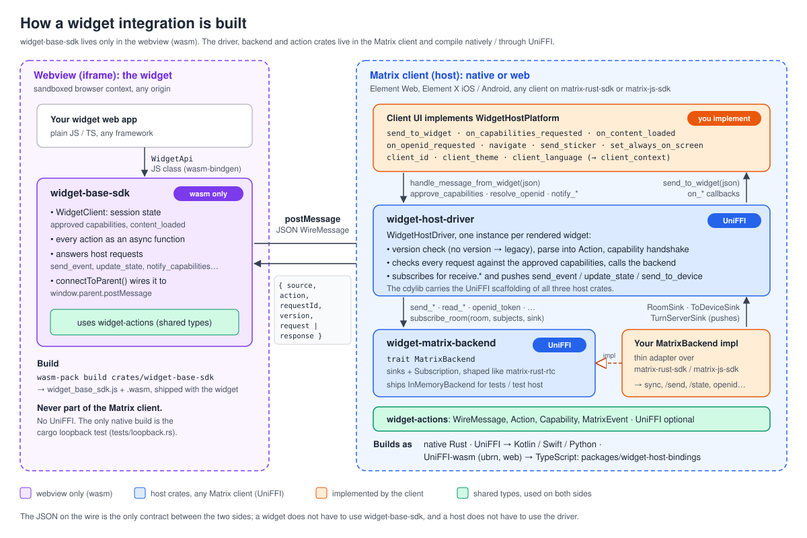
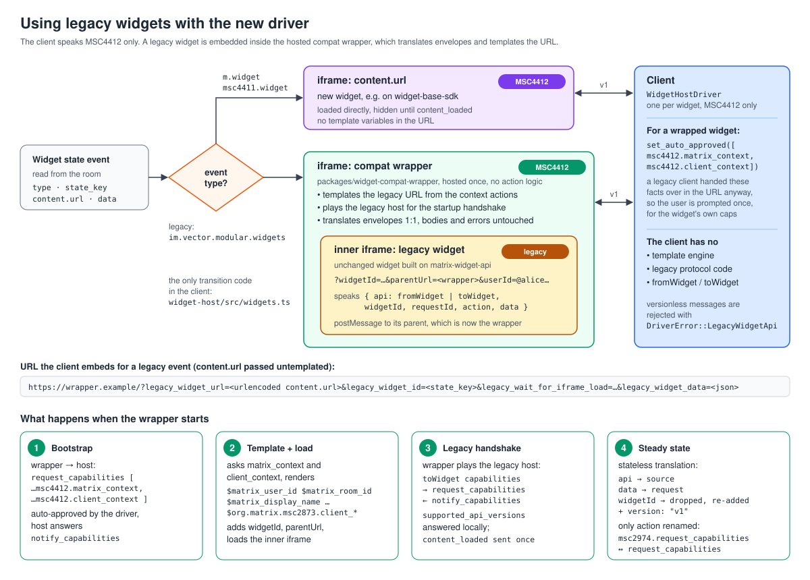
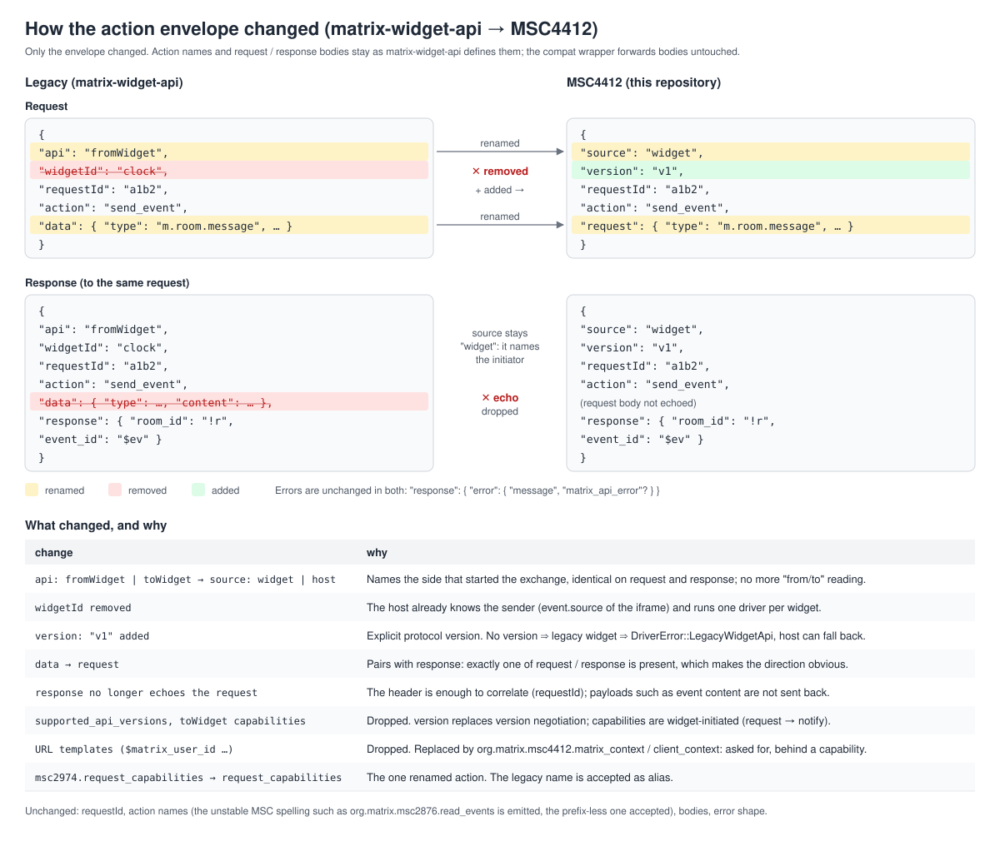
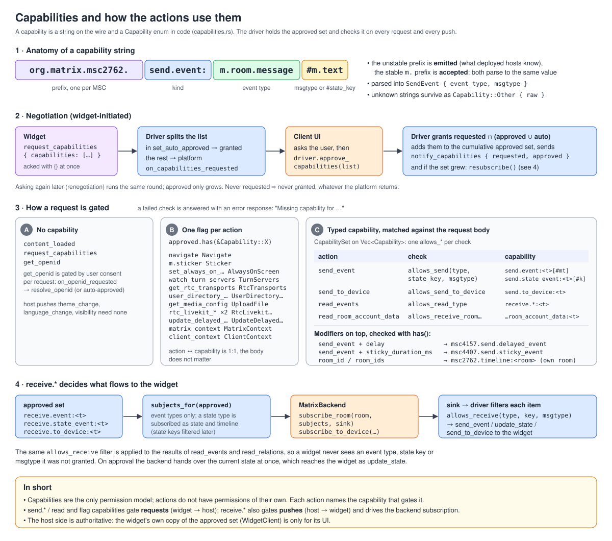
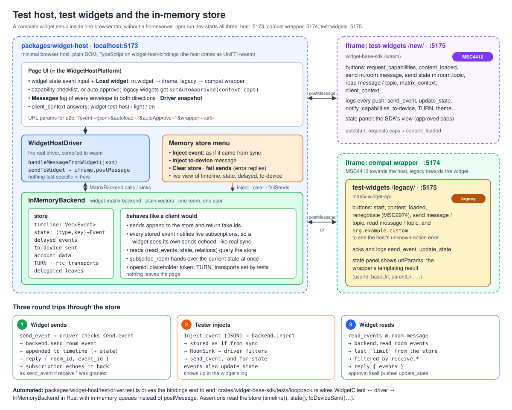

# Diagrams

Overview diagrams of this repository. The SVGs are hand-written and can be edited as text.

## Modules at a glance

| module | where it runs | what it does |
|---|---|---|
| `crates/widget-actions` | both sides, optional UniFFI | Shared types only: the `WireMessage` envelope, the typed `Action` tree, `Capability`, `MatrixEvent`. No I/O, no state. |
| `crates/widget-base-sdk` | **webview only** (wasm) | `WidgetClient` + the `WidgetApi` JS class: widget session state and every action as an async function. |
| `crates/widget-host-driver` | Matrix client, UniFFI | `WidgetHostDriver`: one per widget, handles the handshake, checks capabilities, calls the backend, pushes events. |
| `crates/widget-matrix-backend` | Matrix client, UniFFI | `MatrixBackend` trait that the client implements once per Matrix SDK. Includes `InMemoryBackend`. |
| `crates/uniffi-bindgen` | tooling | Generates Kotlin / Swift / Python bindings. |
| `packages/widget-host-bindings` | browser | The host crates as TypeScript + wasm (ubrn, web flavour). |
| `packages/widget-compat-wrapper` | browser, hosted | Runs a legacy matrix-widget-api widget on an MSC4412 host. |
| `packages/widget-host` | browser | Minimal test host on the in-memory backend. |
| `packages/test-widgets` | browser | A legacy and an MSC4412 test widget. |

## 1. How a widget integration is built

widget-base-sdk runs only in the webview and is shipped as wasm. The driver, backend and actions
crates live in the Matrix client and build natively or through UniFFI. The client provides two
implementations: `WidgetHostPlatform` (UI) and `MatrixBackend` (its Matrix SDK).

## 2. Using legacy widgets with the new driver

## 3. How the action envelope changed

## 4. The widget-actions crate: wire vs. typed

## 5. The actions, grouped

Core is the MSC4412 handshake plus media download / media config. Experimental is everything else that works today but is not specced yet. Security / edge cases are actions we would rather not keep: multi-room access, the user directory, and client-UI features. The code does not treat the groups differently.

## 6. Capabilities

## 7. Test host, test widgets and the in-memory store

