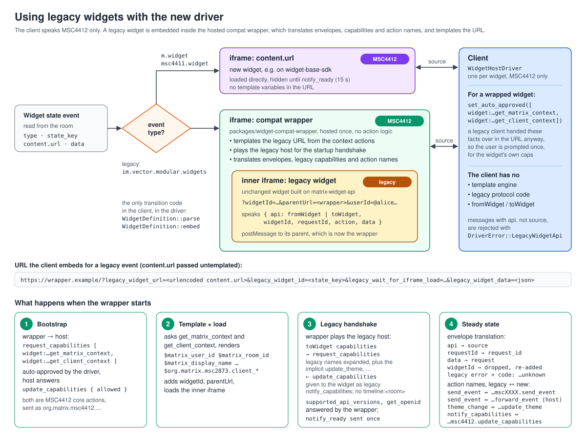
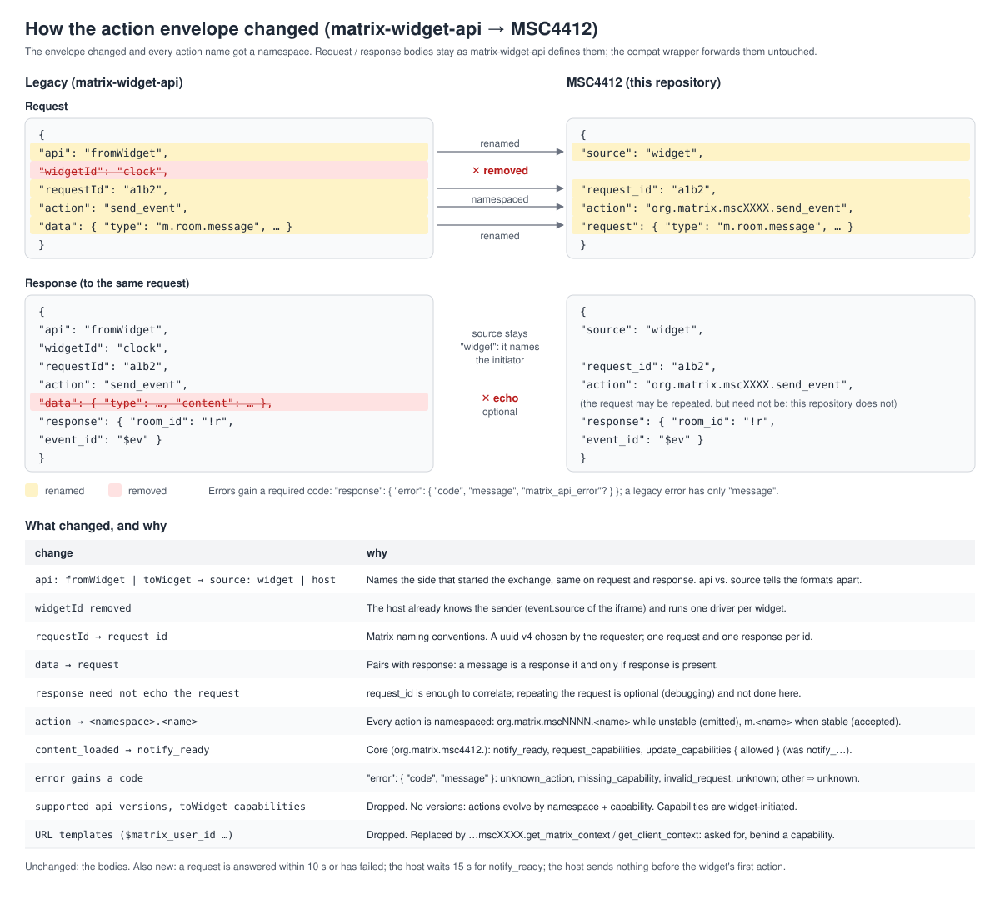
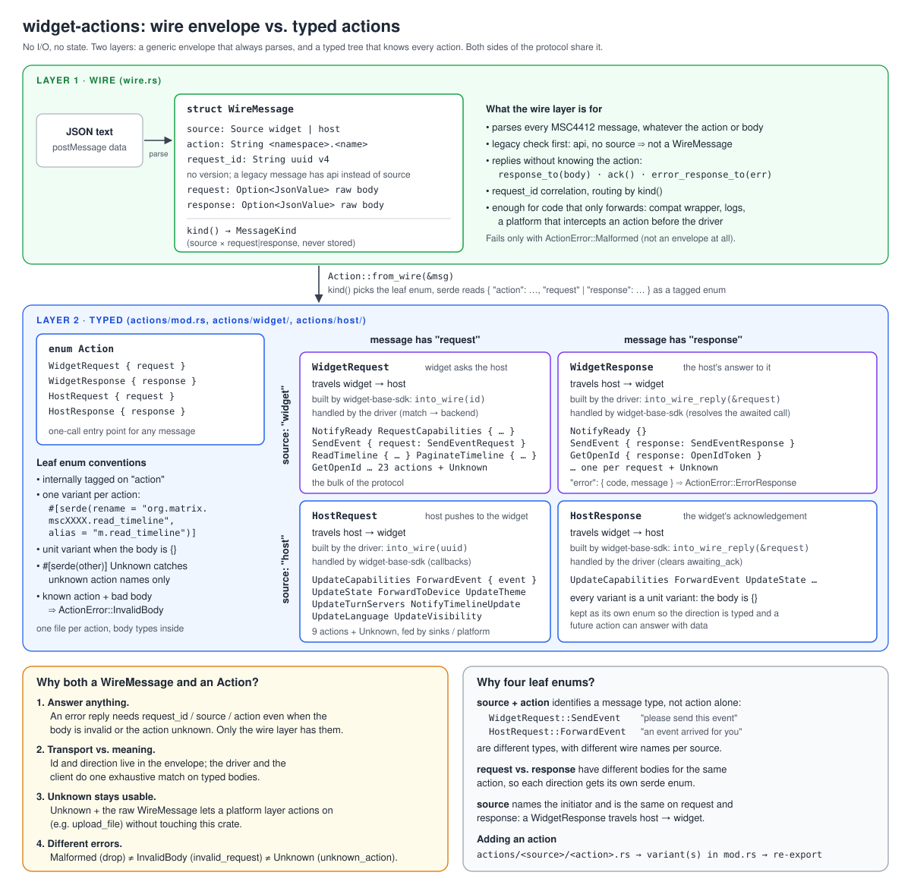
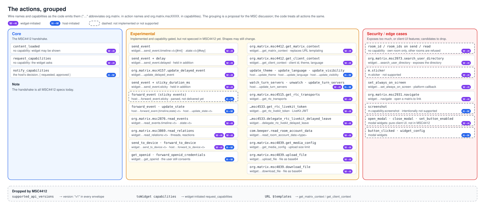
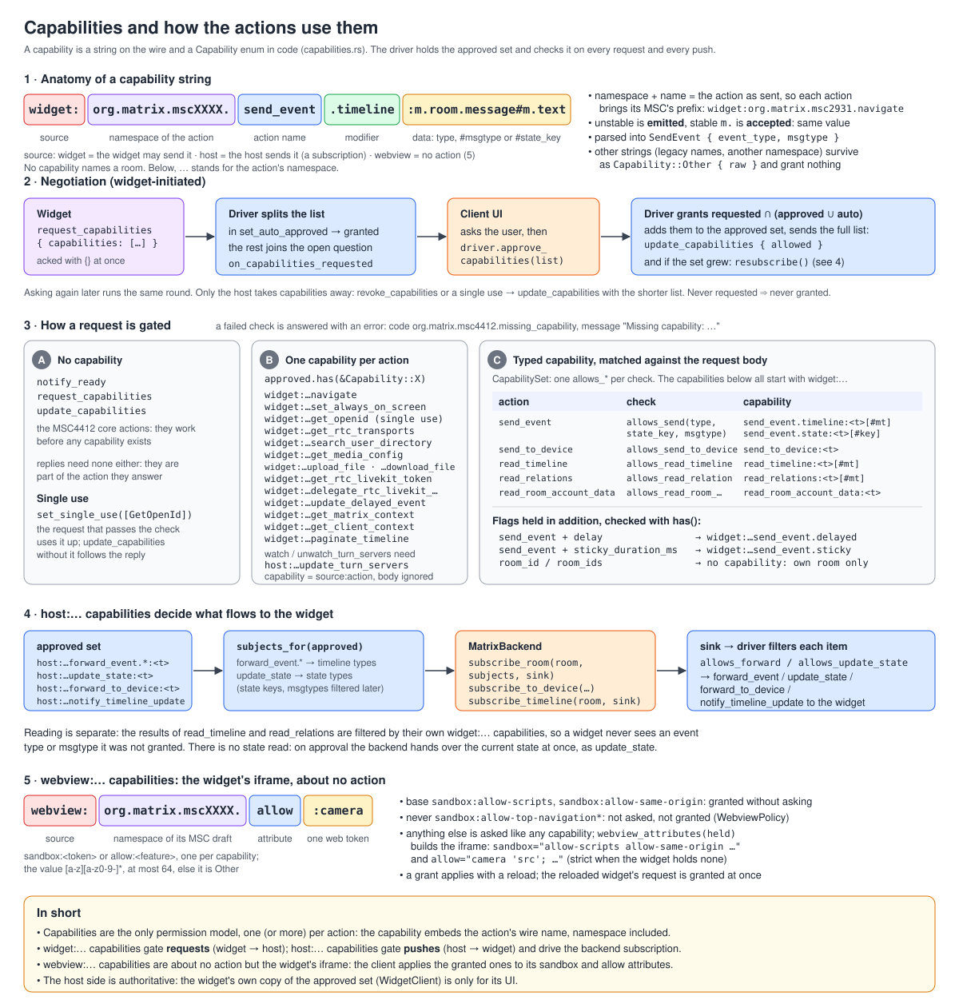
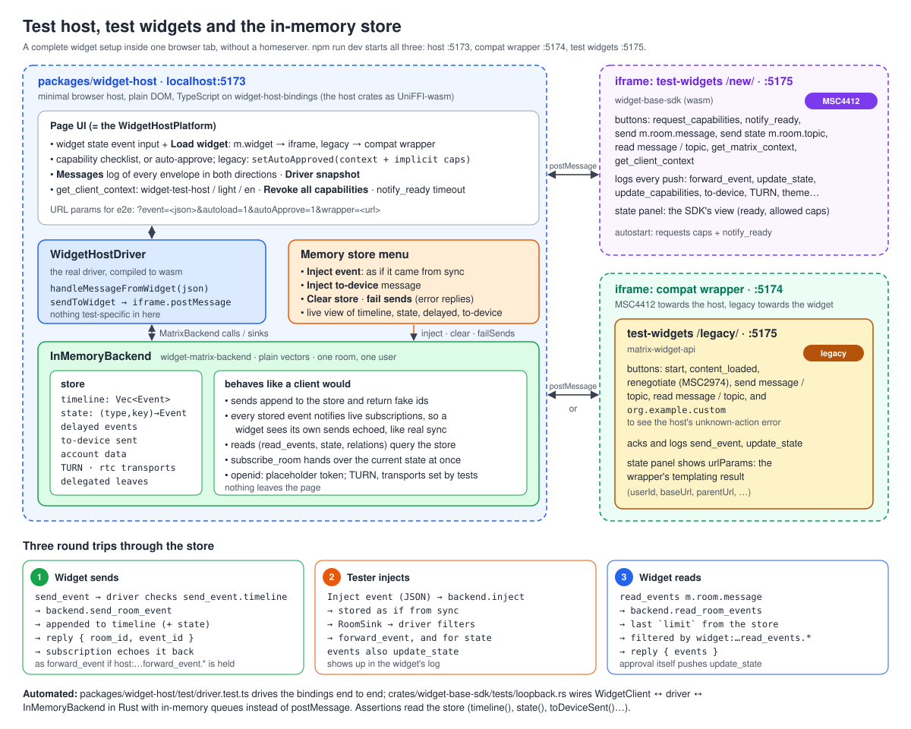

# Diagrams

Overview diagrams of this repository. The SVGs are hand-written and can be edited as text; keep
them valid XML (`xmllint --noout`) and check that text still fits its box. The crates and packages
are listed in the [root README](../../README.md).

## 1. How a widget integration is built

matrix-widget-sdk runs only in the webview and is shipped as wasm. The driver, backend and actions
crates live in the Matrix client and build natively or through UniFFI. The client provides two
implementations: `WidgetHostPlatform` (UI) and `MatrixBackend` (its Matrix SDK).

## 2. Using legacy widgets with the new driver

## 3. How the action envelope changed

## 4. The matrix-widget-actions crate: wire vs. typed

## 5. The actions, grouped

Core is the MSC4412 handshake; experimental is everything that works but is not specced yet;
security / edge cases are actions we would rather not keep. The grouping is a proposal; the code
treats all actions the same.

## 6. Capabilities

## 7. Test host, test widgets and the in-memory store

## Widget use cases

Why the working group works on Iframe + Widget API first: the result of the widget clinic meeting
on 27 October 2026, with two diagrams that rank the solutions for extending Matrix beyond chat and
sort the collected use cases. See [widget-usecases/README.md](widget-usecases/README.md).
