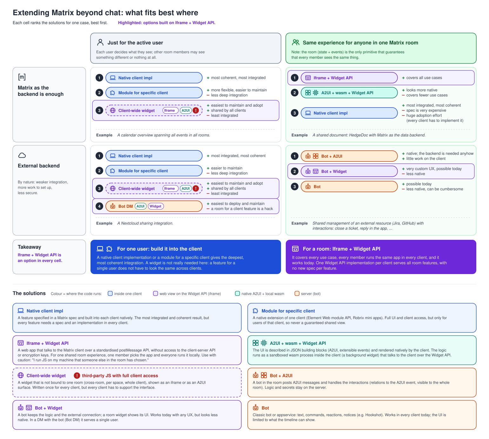

# 08 · Extending Matrix beyond chat: what fits best where



## The idea

There are many ways to build features on top of Matrix that go beyond chat: native client
features, client modules, widgets, A2UI, bots. This diagram answers one question: **which of them
fits best for which kind of feature**, and it makes one argument: **for features shared by a room,
Iframe + Widget API is the best option, and it is an option everywhere.**

Two questions place a feature in the grid:

1. **Who sees it?** (columns)
   - *Just for the active user*: each user decides what they see. Other room members may see
     something different or nothing.
   - *Same experience for anyone in one Matrix room*: the room (its state and events) is the only
     primitive that guarantees that every member sees the same thing.
2. **Where do logic and data live?** (rows)
   - *Matrix as the backend is enough*: everything the feature needs lives in room events.
   - *External backend*: an outside service is needed. By nature this means weaker integration,
     more work to set up and less security.

Each of the four cells **ranks** the solutions for that case, best first, with pros (green `+`),
cons (red `–`) and one example use case at the bottom of the cell.

| | just for the user | anyone in the room |
|---|---|---|
| **Matrix as the backend** | 1 Native client impl · 2 Module for specific client · 3 Client-wide widget | 1 Iframe + Widget API · 2 A2UI + wasm + Widget API · 3 Native client impl |
| **External backend** | 1 Native client impl · 2 Module · 3 Client-wide widget · 4 Bot DM | 1 Bot + A2UI · 2 Bot + Widget · 3 Bot |

Examples per cell: calendar overview of all rooms (top left), HedgeDoc with Matrix as the data
backend (top right), Nextcloud sharing (bottom left), managing Jira / GitHub with interactions such
as closing a ticket (bottom right).

### Below the table

- **Takeaway**: one box per column.
  - Left (blue), *for one user, build it into the client*: a native implementation or a module
    integrates best, and a single-user feature does not have to look the same across clients, so a
    widget is not really needed.
  - Right (purple), *for a room, Iframe + Widget API*: covers every use case, every member runs the
    same app in every client, it works today, and one Widget API implementation per client serves
    all room features without a new spec per feature.
  - The label on the left says that Iframe + Widget API is an option in every cell.
- **The solutions**: one box per solution with its background (what it is, how it runs, trade-offs).

## Visual language

| element | meaning |
|---|---|
| colour of a pill | where the code runs: **blue** inside one client (native, module) · **purple** web view on the Widget API (iframe) · **teal** native A2UI + local wasm · **orange** server (bot) |
| purple band behind a ranked entry | the option is built on Iframe + Widget API |
| sub-pills inside a pill | variants, e.g. *Client-wide widget* as `Iframe` or `A2UI`; *Bot DM* with `A2UI` or `Widget` |
| dashed outline + red `!` | tricky security-wise. Used only for *Client-wide widget*; the reason ("third-party JS with full client access") is written once, in its box in the solutions list |
| rank circles 1, 2, 3, 4 | order within the cell, best first |

## Decisions behind the content

These came from discussions and should be kept unless someone decides otherwise:

- The client-wide widget is a valid rank-3 option for single users (easiest to maintain and adopt),
  but always marked as a security risk: third-party JS gets access to the whole client.
- "Bot DM" for a single user works, but a room for a client feature is a hack.
- A native client implementation for a room feature is the most integrated option, but needs a
  spec and a huge adoption effort (every client has to implement it).
- *Custom client with scoped token* was removed: it is not ranked in any cell.

## For LLMs

The SVG is **generated**. Do not edit `08-extending-matrix.svg` by hand; edit
`08-extending-matrix.py` and run it:

```sh
python3 docs/diagrams/widget-usecases/08-extending-matrix.py   # overwrites 08-extending-matrix.svg
xmllint --noout docs/diagrams/widget-usecases/08-extending-matrix.svg
```

The script has no dependencies besides the Python standard library. Its parts, top to bottom:

| name | what it holds |
|---|---|
| `FAM` | colour families `client`, `widget`, `a2ui`, `bot`: `(stroke colour, fill tint)` |
| `ICONS` | 24×24 stroke icons as SVG path snippets |
| `SOL` | every solution: `key: (name, family, [icons], [(sub-pill label, family)], uses Iframe + Widget API)`. The last flag draws the purple band |
| `RISKY` | `key: label` for security-tricky solutions (dashed outline, red `!`, label in the solutions list) |
| `ROWS` | the table: per row `(row icon, row label, [row note lines], personal entries, shared entries)`. An entry is `(solution key, [(sign, note)])`; sign `+`, `-`, `!` or `""` (continues the previous line without a sign) |
| `EXAMPLES` | `(row, column): text` shown at the bottom of each cell |
| `TAKEAWAYS` | the two boxes below the table |
| `LIST` | the solutions list: `(solution key, description)`, wrapped automatically |

Layout is computed: cell heights follow the number of entries and note lines, the total height
follows the content. The page is 1540 px wide; the columns start at x = 285 and x = 900 and are 600 px
wide.

### Pitfalls

- **Text colour**: the stylesheet sets `text { fill: … }`, which beats a `fill="…"` attribute. The
  `text()` helper therefore turns `fill="…"` into `style="fill:…"`. Always draw text through it.
- **Text width is estimated** (about 7.3 px per character for 13 px semibold, 6.3 px for 12 px
  regular). Keep note lines short (≈ 40 characters next to a pill) and check long strings visually.
- **Checking the result** on macOS: `qlmanage -t -s 1540 -o <dir> 08-extending-matrix.svg` renders a
  PNG, but crops it to a square. To inspect a region, copy the SVG with a changed `viewBox`
  (e.g. `viewBox="770 0 770 1400"`) and render that copy.
- When deleting temporary renders, list the full file paths; no globs.

### Related

- [09-beyond-chat-use-cases.md](09-beyond-chat-use-cases.md): the same grid filled with concrete use
  cases.
- [README.md](README.md): where these diagrams come from (the widget clinic meeting on
  2026-10-27) and the conclusions drawn from them.
