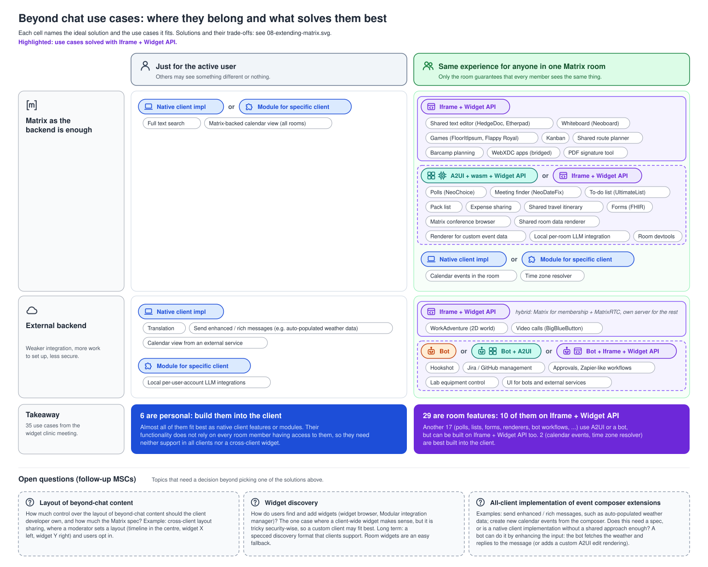

# 09 · Beyond-chat use cases: where they belong and what solves them best



## The idea

[08-extending-matrix](08-extending-matrix.md) ranks the *solutions* per case. This diagram takes
the concrete *use cases* collected in the widget clinic meeting on 2026-10-27
([README.md](README.md)) and sorts each one into the same
grid, with its **ideal technical solution**. It shows how much of the real demand is room features,
and that Iframe + Widget API can serve nearly all of them.

The grid is the one from diagram 08:

- **Columns**: *just for the active user* or *same experience for anyone in one Matrix room*.
- **Rows**: *Matrix as the backend is enough* or *external backend*.

Inside a cell the use cases are **grouped by solution**: a solution pill, then the use cases as
small chips underneath. A group can name alternatives: "A2UI + wasm + Widget API **or** Iframe +
Widget API" means the first is the best fit and the second works as well.

### Current sorting

| | just for the user | anyone in the room |
|---|---|---|
| **Matrix as the backend** | Native client impl or Module: full text search, Matrix-backed calendar view (all rooms) | **Iframe + Widget API**: shared text editor (HedgeDoc, Etherpad), whiteboard (Neoboard), games, kanban, route planner, barcamp planning, bridged WebXDC apps, PDF signature tool · **A2UI + wasm + Widget API or Iframe + Widget API**: polls, meeting finder, to-do list, pack list, expense sharing, travel itinerary, FHIR forms, conference browser, room data renderer, custom event renderer, per-room LLM, room devtools · **Native client impl or Module**: calendar events in the room, time zone resolver |
| **External backend** | Native client impl: translation, send enhanced / rich messages, calendar view from an external service · Module for specific client: local per-user-account LLM integrations | **Iframe + Widget API** (hybrid: Matrix for membership + MatrixRTC, own server for the rest): WorkAdventure, BigBlueButton · **Bot or Bot + A2UI or Bot + Iframe + Widget API**: Hookshot, Jira / GitHub management, approvals and Zapier-like workflows, lab equipment control, UI for bots and external services |

### Below the table

- **Takeaway**, computed from the table: how many use cases there are, how many are personal
  (build them into the client), how many are room features, and how many of those use Iframe +
  Widget API directly or as an alternative.
- **Open questions (follow-up MSCs)**: topics that need a decision rather than a pick from the
  table.
  - *Layout of beyond-chat content*: how much control over the layout should the client developer
    own, and how much the Matrix spec? (Cross-client layout sharing set by a moderator.)
  - *Widget discovery*: widget browser, integration manager. The one case where a client-wide widget
    makes sense, but it is tricky security-wise; a custom client may fit best. Long term: a specced
    discovery format; room widgets as an easy fallback.
  - *All-client implementation of event composer extensions*: rich messages (auto-populated weather
    data), creating calendar events from the composer. Spec, or native client implementations only?
    A bot can enhance the input today (fetch the weather and reply, or a custom A2UI edit rendering).

## Visual language

Same colours as diagram 08 (blue client, purple Widget API iframe, teal A2UI, orange bot), plus:

| element | meaning |
|---|---|
| solid purple band behind a group | the group's first choice is Iframe + Widget API |
| dashed purple band | Iframe + Widget API is an alternative, not the first choice |
| no band | the group does not involve Iframe + Widget API |
| grey chip | one use case |
| italic note next to a pill | a remark on the whole group (e.g. "hybrid") |

Difference to diagram 08: here *Bot + A2UI* is teal (A2UI) and *Bot* is a separate orange pill.

## Decisions behind the sorting

These came from discussions and should be kept unless someone decides otherwise:

- Apps with their own server that still use Matrix room membership and MatrixRTC (WorkAdventure,
  BigBlueButton) are Iframe + Widget API, marked as hybrid. The PDF signature tool uses Matrix as the
  backend.
- Rich messages are a feature of the *sending* client (receivers need nothing), so they are
  personal; whether this needs a spec is an open question.
- Layout sharing and widget discovery are not use cases in the grid; they are open questions.
- Room devtools are a room tool on A2UI or Iframe + Widget API, not a client module.
- Calendar events in the room and the time zone resolver are room features, but best built into the
  client (native or module).

## For LLMs

The SVG is **generated**. Do not edit `09-beyond-chat-use-cases.svg` by hand; edit
`09-beyond-chat-use-cases.py` and run it:

```sh
python3 docs/diagrams/widget-usecases/09-beyond-chat-use-cases.py   # overwrites 09-beyond-chat-use-cases.svg
xmllint --noout docs/diagrams/widget-usecases/09-beyond-chat-use-cases.svg
```

Standard library only. The parts that hold content:

| name | what it holds |
|---|---|
| `FAM`, `ICONS` | colour families and icons, as in `08-extending-matrix.py` |
| `SOL` | `key: (name, family, [icons], uses Iframe + Widget API)` |
| `CELLS` | the sorting. Key `(row, column)`: row 0 = Matrix as the backend, 1 = external; column 0 = just for the user, 1 = room. Value: a list of groups, each `(solution, note, [use cases])` or `(solution, note, [alternative solutions], [use cases])` |
| `ALT_IFRAME` | shorthand for `["iframe"]` as the alternatives list |
| `ROWS` | row icon, label and note lines |
| `TAKEAWAYS` | the two boxes below the table. Their numbers come from `count()` over `CELLS` |
| `QUESTIONS` | the open questions: `(title, body)`, laid out side by side, wrapped automatically |

To **move a use case**, move its string between the lists in `CELLS`. To **add a group**, append a
tuple to the cell's list. Heights, chip flow and the takeaway numbers follow automatically; only
the wording of the takeaway text (e.g. the list in brackets) may need an update.

### Pitfalls

- **Text colour**: always draw text through `text()`, which turns `fill="…"` into `style="fill:…"`
  (the stylesheet's `text { fill }` beats a plain attribute).
- **Widths are estimated** (≈ 6.6 px per character for chips, 7.3 px for pills). A group's pills
  plus "or" separators must stay within the 600 px cell; three pills (the bot group) is the current
  maximum.
- **Takeaway boxes** hold three lines of text (`box_h`); longer text needs a bigger box.
- **Checking the result** on macOS: `qlmanage -t -s 1540 -o <dir> 09-beyond-chat-use-cases.svg`
  renders a square-cropped PNG; to inspect a region, render a copy with a changed `viewBox`.
- When deleting temporary renders, list the full file paths; no globs.

### Related

- [08-extending-matrix.md](08-extending-matrix.md): the ranking of the solutions and their
  descriptions.
- [README.md](README.md): where these diagrams come from and the conclusions drawn from them.
