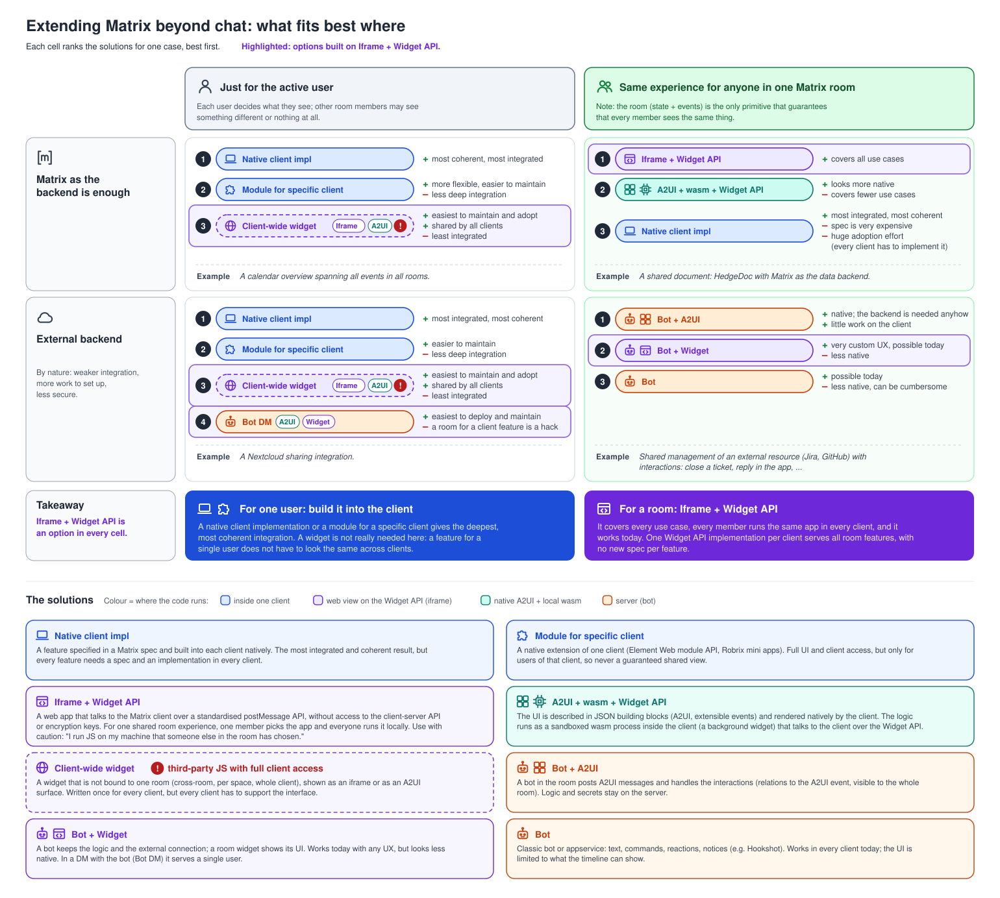
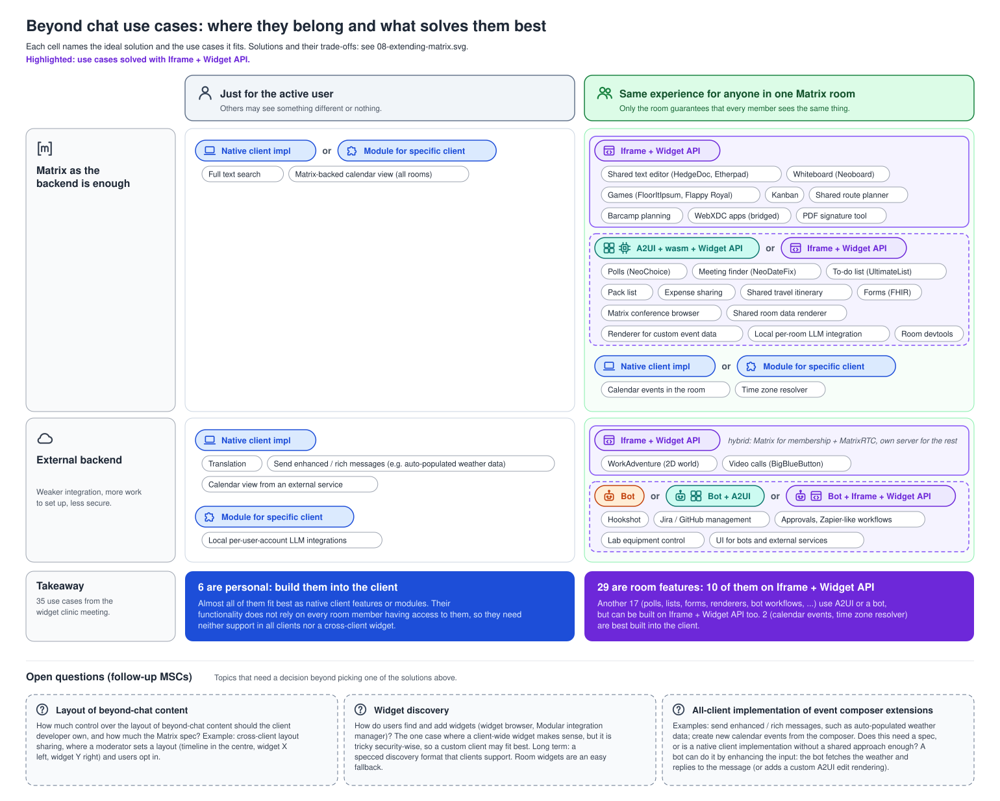

# Widget use cases: why Iframe + Widget API first

These diagrams are the result of the **widget clinic meeting on 27 October 2026**. The meeting
collected use cases for Matrix beyond chat and the technical solutions that could serve them.

The diagrams show why **Iframe + Widget API** is the solution that checks the most boxes, and
explain why the working group works on this approach first.

## The conclusions

- **Iframe + Widget API first.** It is the best option for features shared by a room, and an option
  in every other case as well. Every member of a room runs the same app in every client, it covers
  all use cases and it works today. One Widget API implementation per client serves all room
  features, without a new spec per feature.
- **A2UI overlaps, and is the ideal solution for bots.** A2UI (UI described in JSON building blocks
  and rendered natively by the client) covers part of the same ground. For bots it is the best fit:
  the bot already runs a backend, and the client only renders. It should get a **parallel work
  stream in the context of extensible events**.
- **A2UI + wasm is a complete alternative to the webview-based widget.** The logic runs as a
  sandboxed wasm process in the client and the UI is rendered natively. A webview is more flexible,
  but less elegant. The ecosystem benefits more from Iframe first, because an iframe can host both
  approaches as well: wasm + canvas, or wasm + A2UI. Iframe first does not steer away from A2UI
  either: A2UI + wasm talks to the client over the same Widget API, so it reuses everything built
  for the iframe approach (actions, capabilities, the host driver). Work on the Widget API moves
  both approaches forward in the same direction.
- **Features for a single user** fit best as native client features or modules. They do not rely on
  every room member having access, so they need neither support in all clients nor a cross-client
  widget.

## The diagrams

### What fits best where

The solutions ranked per case: who sees the feature (only the active user, or everyone in the
room) and whether Matrix is enough as the backend. Details: [08-extending-matrix.md](08-extending-matrix.md).



### The use cases, sorted

The use cases from the meeting in the same grid, each with its ideal technical solution, plus the
open questions for follow-up MSCs. Details: [09-beyond-chat-use-cases.md](09-beyond-chat-use-cases.md).



## Changing the diagrams

Both SVGs are generated by the Python script next to them (standard library only). Edit the
script, not the SVG, then run it:

```sh
python3 docs/diagrams/widget-usecases/08-extending-matrix.py
python3 docs/diagrams/widget-usecases/09-beyond-chat-use-cases.py
```

The `.md` file of each diagram has a "For LLMs" section with the data structures and pitfalls.
