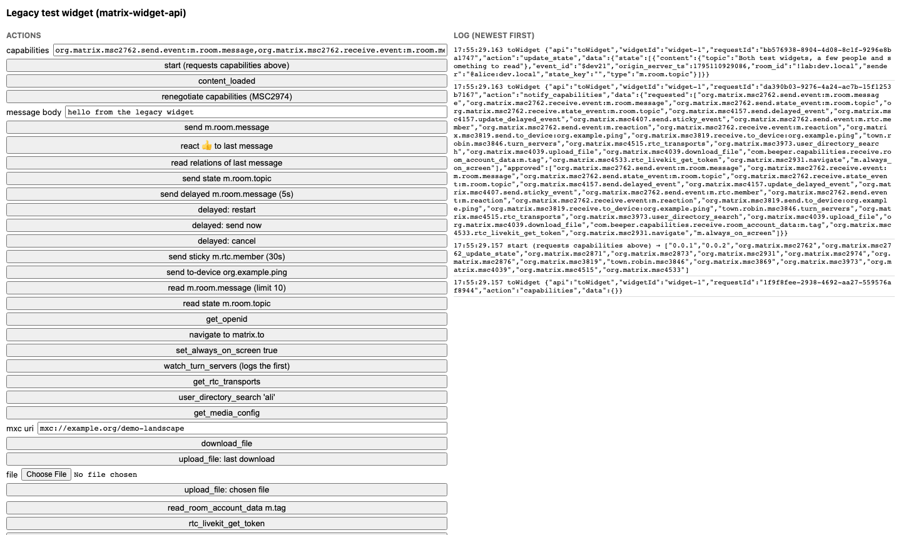
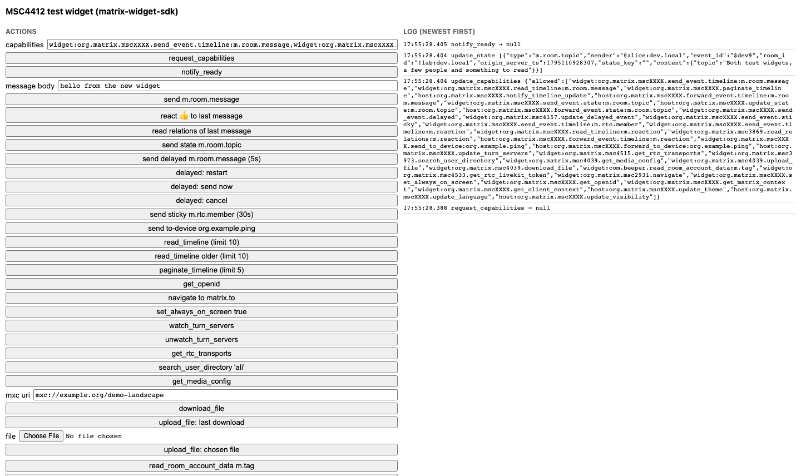
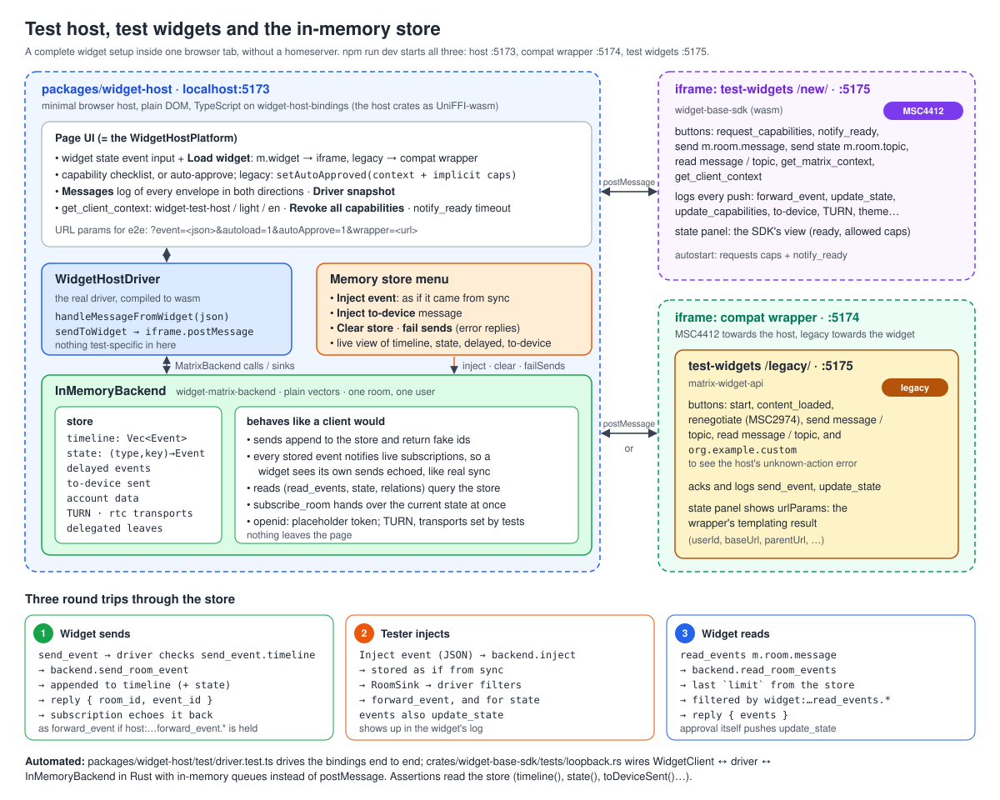

# Test widgets

Two tiny widgets that show the current state and every message that arrives, with a button for
each basic action. They only work when embedded by a widget host, for example `../widget-host`.

| info | screenshot
|---|---|
| **path:** `/legacy/`<br>**build on:** [matrix-widget-api]<br>legacy (`api: fromWidget / toWidget`) |  |
| **path:** `/new/`<br>**build on:** [widget-sdk] (wasm, this repository)<br>MSC4412 (`source: widget / host`) |  |

Both pages have the same layout: an **actions** column (capability list, message body, one
button per action, see `legacy/main.ts` / `new/main.ts`), a **state** panel, and a **log** of
results and incoming host messages, newest first. Incoming host requests are acknowledged and
logged.



- The default capability lists are `legacy/capabilities.ts` (matrix-widget-api names, translated
  by the compat wrapper) and `new/capabilities.ts` (the names of
  `docs/spec-appendix/capability-naming-proposal.md`).
- **File** controls (MSC4039): download an `mxc` URI (default `mxc://example.org/demo-landscape`,
  which the test host seeds), upload the last download or a file from disk. The new widget sends
  base64, the legacy widget a `Blob` that the compat wrapper converts.
- The legacy widget's state panel shows `urlParams`, the query it was loaded with (behind the
  compat wrapper: the templating result). It is also written to the console once on load, for
  headless runs.
- The new widget's **webview** buttons concern its own iframe: request camera + microphone
  (`WEBVIEW_CAPABILITIES`, not in the default list; the host restarts the widget to apply a
  grant), try the camera, open a popup, and log the iframe's `document.featurePolicy` (Chromium).

## URL parameters

| page | parameter | meaning |
|---|---|---|
| both | `autostart=0` | Do nothing on load. Default: the legacy widget requests capabilities and starts; the new widget sends `request_capabilities` and `notify_ready`. |
| new | `log=<level>` | What matrix-widget-sdk writes to the console: `off`, `error`, `warn` (default), `info`, `debug`, `trace`. `logFilter=<spec>` adds `RUST_LOG`-style overrides per module. |
| legacy | `widgetId` | The widget id, as legacy clients pass it. Required for the legacy transport. |
| legacy | `parentUrl` | The widget only posts to this origin (as Element widgets do). Without it, `*`. The compat wrapper always sets it to itself. |

## Running

```sh
npm run wasm             # once, from the repository root (needs wasm-pack)
npm install              # from the repository root
npm run dev              # serves both at http://localhost:5175/legacy/ and /new/
npm run dev:legacy       # same server, opens the legacy page
npm run dev:new          # same server, opens the new page
npm run build            # static multi-page build in dist/
```

`npm run widget-shots -w @matrix-widget-tools/widget-host` opens both widgets in the widget host
and writes `screenshots/new.png` and `screenshots/legacy.png` (only the widget, not the host).

The pages use relative paths, so the build can be served under a sub-path (`npx vite build --base /some/path/`). The [dev site](../../README.md#dev-site-github-pages) serves
both pages at `widgets/new/` and `widgets/legacy/`, next to a widget host that uses them.

[matrix-widget-api]: https://github.com/matrix-org/matrix-widget-api
[widget-sdk]: https://github.com/toger5/matrix-widget-sdk/tree/main/crates/matrix-widget-sdk
