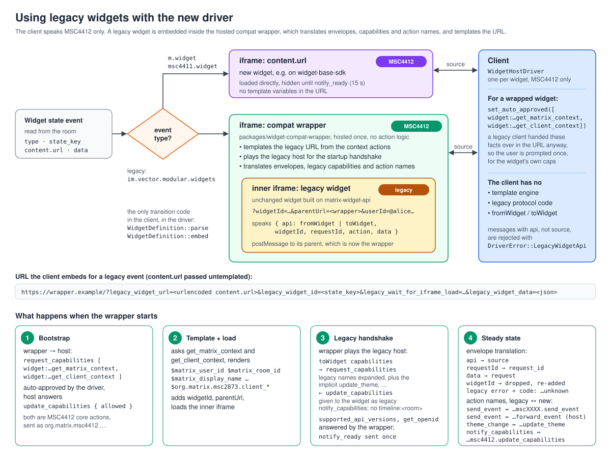
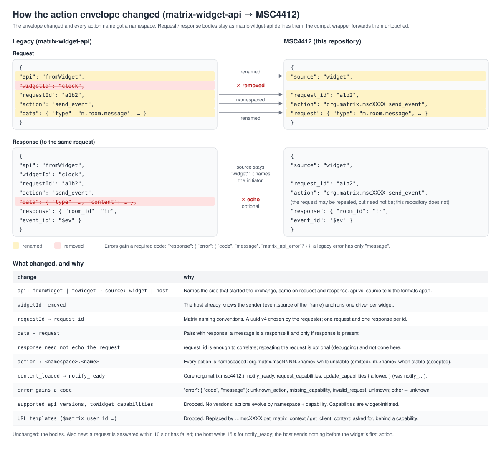

# Widget compat wrapper

A hosted widget that makes a **legacy widget** (built on [matrix-widget-api], `api: fromWidget | toWidget`)
look like an **MSC4412 widget** to its host. The host embeds the wrapper; the wrapper embeds the legacy
widget in an inner iframe and translates between the two protocols.

It translates envelopes, action names and capability names and passes other bodies through,
except file payloads (`Blob` ↔ base64) and legacy error responses (which get the `code` MSC4412
requires). The wrapper is the **only** place legacy names are understood: the host knows only the
names of [`capability-naming-proposal.md`](../../docs/spec-appendix/capability-naming-proposal.md).



## How a client uses it

The client speaks MSC4412 only and keeps one piece of transition code, a check on the widget
state event:

- **Legacy event** (`im.vector.modular.widgets`): embed
  `https://example.org/compat-wrapper/?legacy_widget_url=<urlencoded content.url>&legacy_widget_id=<state_key>`
  as an MSC4412 widget with `uses_widget_api: true`. The URL is passed **untemplated**; the wrapper
  resolves the template variables.
- **New event** (`m.widget`): embed `content.url` directly, unless it is a page of the client's own
  compat wrapper (that would load an unchecked `legacy_widget_url` on the client's origin).

`matrix-widget-host-driver` does both: a `WidgetHostDriver` made from a legacy definition, with
the wrapper URL in `EmbedOptions`, hands the wrapper's URL to `WidgetHostPlatform::load_iframe`
with `legacy_widget_url`, `legacy_widget_id`, `legacy_wait_for_iframe_load` and
`legacy_widget_data` set, and refuses a widget of either kind whose URL is a page of the wrapper.

## Query parameters

| parameter | required | from the legacy state event | meaning |
|---|---|---|---|
| `legacy_widget_url` | yes | `content.url`, **untemplated** | Templated by the wrapper; `widgetId` is added if missing and `parentUrl` is set to the wrapper. Only an absolute `http:` / `https:` URL is loaded, see [below](#which-urls-the-wrapper-loads). |
| `legacy_widget_id` | no | `state_key` | `widgetId` on every legacy message and `$matrix_widget_id`. Default: the `widgetId` query parameter of `legacy_widget_url`; one of the two must exist. |
| `legacy_widget_name` | no | `content.name` | Accessible name (`title`) of the inner iframe. Default: the widget id. |
| `legacy_wait_for_iframe_load` | no | `content.waitForIframeLoad` (default `true`) | When the capability round starts, see [Startup](#startup). |
| `legacy_widget_data` | no | `content.data` as JSON | Extra `$key` template variables. |
| `client_origin` | no | | Target origin for `postMessage` to the host. Default `*`; set it in production. |
| `log_level` | no | | Console output (prefix `[widget-compat-wrapper]`): `off`, `error`, `warn` (default: dropped and refused messages), `info`, `debug` (one line per message). |

## What the wrapper does

### Bootstrap: templating the legacy URL

Before the inner iframe exists, the wrapper requests
`widget:org.matrix.mscXXXX.get_matrix_context` and `widget:org.matrix.mscXXXX.get_client_context`
(plus the webview capabilities of [the iframes](#the-iframes)), then fetches both contexts and
renders the URL:

| variable | source |
|---|---|
| `$matrix_user_id`, `$matrix_room_id`, `$matrix_display_name`, `$matrix_avatar_url` | `get_matrix_context` |
| `$org.matrix.msc3819.matrix_device_id`, `$org.matrix.msc4039.matrix_base_url` | `get_matrix_context` |
| `$org.matrix.msc2873.client_id`, `$org.matrix.msc2873.client_theme`, `$org.matrix.msc2873.client_language` | `get_client_context` |
| `$matrix_widget_id` | `legacy_widget_id` |
| `$<key>` | `legacy_widget_data` |

Values are URI-encoded and unknown variables stay as they are. A refused context leaves its
variables empty; the widget still loads. Other host requests in this phase get `invalid_request`.
So a host prompts twice for a wrapped widget (the wrapper's context capabilities, then the
widget's own) unless it grants the context capabilities without asking.

### The iframes

A host with strict iframes ([`strict-webview-defaults.md`](../../spec/patch/msc4411/strict-webview-defaults.md))
gives a widget only `allow-scripts allow-same-origin` until it holds webview capabilities
([`webview-capabilities.md`](../../spec/patch/new/webview-capabilities.md)). The wrapper requests the
iframe Element Web gives every widget (`LEGACY_WEBVIEW_CAPABILITIES` in `src/capabilities.ts`):

| `sandbox` (`webview:org.matrix.mscXXXX.sandbox:<token>`) | `allow` (`webview:org.matrix.mscXXXX.allow:<feature>`) |
|---|---|
| `allow-forms`, `allow-popups`, `allow-popups-to-escape-sandbox`, `allow-same-origin`, `allow-scripts`, `allow-presentation`, `allow-downloads` | `microphone`, `camera`, `encrypted-media`, `autoplay`, `display-capture`, `clipboard-write`, `clipboard-read`, `fullscreen` |

A host that keeps legacy widgets working grants them unasked and builds the wrapper's iframe with
them from the start (`matrix-widget-host-driver`: `legacy_auto_approved`). The inner iframe always
has these attributes, whatever the host granted; a legacy widget cannot request webview
capabilities. Exception: a legacy widget on the wrapper's own origin loads without
`allow-same-origin` (its origin is opaque, messages go to `*` on that one window).

### Which URLs the wrapper loads

The wrapper often runs on its client's origin with `allow-same-origin`, so it loads only an
**absolute `http:` or `https:` URL that names its own host**, the rule of `widget_url_problem` in
`matrix-widget-host-driver` (`src/url.ts`; tested against
`crates/matrix-widget-host-driver/tests/widget_urls.json`). It checks the template when it reads
its configuration, and the templated URL before creating the inner iframe (a value cannot change
the scheme, but can make the URL invalid: `https://$server/` with `server` = `widgets.example:8443`).

A refused URL creates no inner iframe. The wrapper logs and shows the reason (naming the scheme,
never the URL), never sends `notify_ready`, and answers later host requests with `invalid_request`.
A client should still check the URL itself; the wrapper's check protects clients that do not.

### Envelope and action names

| legacy | MSC4412 |
|---|---|
| `api: "fromWidget"` / `"toWidget"` | `source: "widget"` / `"host"` |
| `widgetId` | absent; added from `legacy_widget_id` |
| `requestId`, `data` | `request_id` (same value), `request` |
| response = echo of the request + `response` | response = header + `response` |
| `error: { message }` from the widget | `error: { code: "org.matrix.msc4412.unknown", message }` |

Messages are routed by `event.source` (parent vs. inner iframe); a message of the wrong format or
with another `widgetId` is ignored. Legacy action names that differ from the host's are renamed
per direction (`LEGACY_TO_NEW` in `src/envelope.ts`); everything else passes through, so an action
the host does not implement gets the host's own error.



### Capabilities (`src/capabilities.ts`)

Every legacy capability stands for a fixed set of new ones. The wrapper requests that set and
reports the legacy capability as approved only when the host approved **all** of it.

| legacy capability (its MSC prefix or `m.`) | requested from the host (`…` = the action's namespace) |
|---|---|
| `send.event:<t>` | `widget:…send_event.timeline:<t>` |
| `send.state_event:<t>` | `widget:…send_event.state:<t>` |
| `receive.event:<t>` | `widget:…read_timeline:<t>`, `widget:…read_relations:<t>`, `host:…forward_event.timeline:<t>`, `widget:…paginate_timeline`, `host:…notify_timeline_update` |
| `receive.state_event:<t>` | `host:…update_state:<t>`, `host:…forward_event.state:<t>` |
| `timeline:<room>` | nothing: one widget, one room; never reported as approved |
| `send.to_device:<t>` / `receive.to_device:<t>` | `widget:…send_to_device:<t>` / `host:…forward_to_device:<t>` |
| `receive.room_account_data:<t>` | `widget:…read_room_account_data:<t>` |
| `send.delayed_event` / `update_delayed_event` | `widget:…send_event.delayed` / `widget:…update_delayed_event` |
| `send.sticky_event` / `receive.sticky_event` | `widget:…send_event.sticky` / `host:…forward_event.sticky` |
| `turn_servers` | `host:…update_turn_servers` |
| `rtc_transports` | `widget:…get_rtc_transports` |
| `user_directory_search` | `widget:…search_user_directory` |
| `upload_file` | `widget:…upload_file`, `widget:…get_media_config` |
| `download_file` | `widget:…download_file` |
| `navigate` | `widget:…navigate` |
| `rtc_livekit_get_token` / `rtc_livekit_delegate_delayed_leave` | `widget:…get_rtc_livekit_token` / `widget:…delegate_rtc_livekit_delayed_leave` |
| `m.always_on_screen` | `widget:…set_always_on_screen` |
| anything else (`m.sticker`, custom strings) | unchanged |

`<t>` keeps its `#<msgtype>` / `#<state_key>` suffix. A host answer in the stable namespace
(`widget:m.navigate`) is understood.

- **Always requested:** `host:…update_theme`, `host:…update_language`, `host:…update_visibility`
  (the legacy api needs no capability for them; `legacy_auto_approved` grants them unasked).
- **`update_capabilities { allowed }` becomes `notify_capabilities { requested, approved }`:**
  `requested` is the widget's latest list, `approved` every legacy capability it ever requested
  whose whole set is in `allowed`, in the widget's own spelling. It shrinks when the host takes
  capabilities away. A partial grant is reported as not approved, but the granted parts work.

### Reading events (`src/readEvents.ts`)

The host has no `org.matrix.msc2876.read_events`; the wrapper answers it with `read_timeline`,
`paginate_timeline` and `notify_timeline_update` ([draft](../../spec/patch/new/timeline-reading.md)),
paginating while the answer is short of `limit`, for at most 7 s, newest first. State reads are
answered from the host's `update_state` pushes. Only the widget's own room is served; `since` is
not supported.

### OpenID

An MSC4412 host hands out a token only while the widget holds `widget:…get_openid`, granted per
token ([`openid-capability.md`](../../spec/patch/new/openid-capability.md)). While it is held, the
widget's `get_openid` gets `{ state: "allowed", ...token }`. Otherwise the widget gets
`{ state: "request" }`, the wrapper requests the capability, and each waiting request later gets
`openid_credentials` with `state: "allowed"` and the token, or `state: "blocked"`.

### File payloads

The MSC4412 file format is `{ "mimetype": "image/png", "base64": "iVBORw0…" }`: a `Blob` does not
survive the JSON strings MSC4412 hosts carry. The wrapper converts the `file` of
`org.matrix.msc4039.upload_file` requests (any `XMLHttpRequestBodyInit` → base64) and
`org.matrix.msc4039.download_file` responses (base64 → `Blob`). The legacy `screenshot` action is
not supported.

### Startup

Legacy capabilities are requested by the host, MSC4412 capabilities by the widget, so the wrapper
plays the legacy host towards the inner iframe:

- `waitForIframeLoad = true` (default): on the inner iframe's `load` the wrapper sends the host
  `notify_ready` and the widget `capabilities`, then requests the translated list from the host. A
  `content_loaded` from the widget gets the legacy error.
- `waitForIframeLoad = false`: the same happens on the widget's `content_loaded`.
- On an inner reload the capability round runs again; `notify_ready` is sent once.
- `supported_api_versions` is answered with matrix-widget-api's `CurrentApiVersions`.
- Renegotiation (`org.matrix.msc2974.request_capabilities`) is translated like the first round.

Legacy widgets built with `new WidgetApi(widgetId, clientOrigin)` only accept a parent at
`clientOrigin`; most derive it from `parentUrl`, which is the wrapper. The legacy 10 s request
timeout still applies between widget and host.

## From npm

```sh
npm install @matrix-widget-sdk/compat-wrapper
```

The package is the built page only (`dist/index.html` and `dist/assets/`, relative paths). Copy
`dist/` into the client's web root (for example `/widget_compatibility_wrapper/`) and pass that URL
as `EmbedOptions.wrapperUrl`.

## Development

```sh
npm install              # from the repository root (npm workspaces)
npm test                 # vitest
npm run dev              # http://localhost:5174/ (standalone)
npm run build            # static output in dist/
```

`src/bridge.ts` is the transport-free state machine, `src/wrapper.ts` the browser glue (config,
iframe, `postMessage`); the other modules are pure translations. For an end-to-end run use the
test host in `../widget-host` with the legacy test widget from `../test-widgets`: the host builds
`src/main.ts` into its own page `/widget_compatibility_wrapper/`.

[matrix-widget-api]: https://github.com/matrix-org/matrix-widget-api
