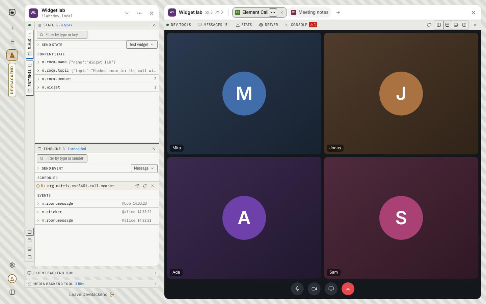
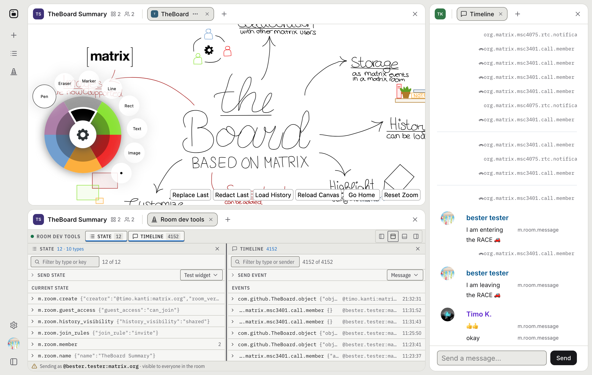
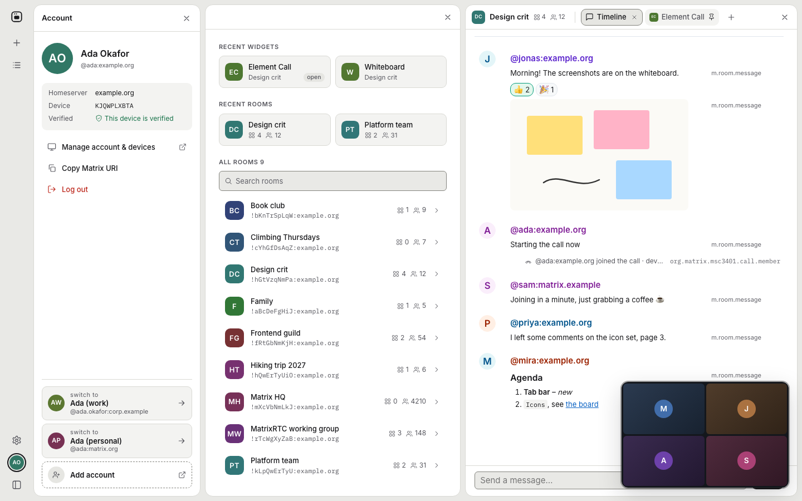
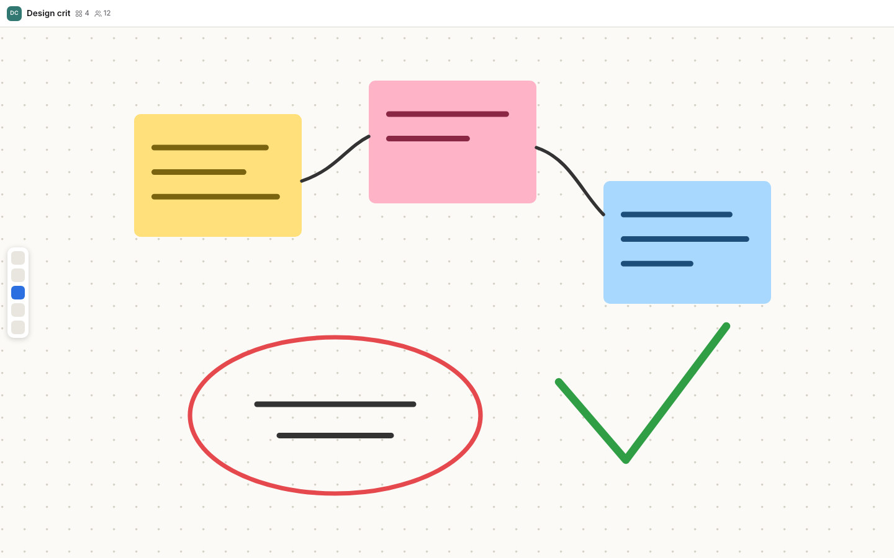
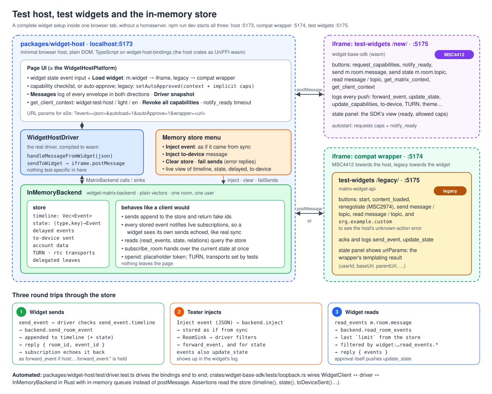

# Widget host

A Matrix client in the browser that opens widgets and shows what they do. It runs the
MSC4412 widget API through `matrix-widget-host-driver` (the UniFFI/wasm bindings in
`../widget-host-bindings`).

## Use cases
- **End-to-end tests:** Playwright drives the host and asserts on the messages, the driver state
  and the room content.
- **Reference implementation of the host side of the sdk:** the driver and the compat wrapper for
  legacy widgets run here as they would in a client.
- **Developing a widget:** run it against mocked rooms, without a homeserver or a full client.
  
- **Debugging a widget in a real room:** log in, open the room's widgets and watch their messages.
  
- **As a matrix client:** The host can be seen as a matrix client with a unusual layout. Room panels first
  `cmd`/`ctrl`+`K` to open a new panel. Tabs as differnt views of the matrix room. Layout how you want them
  to
  
- **As a widget host:** If you just want to share or have users access one specific widget the fullscreen
  experience can be seen as a standalone widget "player".
  
## Features

- **Two modes, one UI.** Logged in, widgets run on a real room (matrix-rust-sdk, or matrix-js-sdk
  in the `js` build). In the **DevBackend**, they run on mocked rooms in memory and nothing leaves
  the page, so tests are fast and repeatable.
- **Copy a room to the DevBackend.** Takes recent events and the state of a real room, so you can
  experiment with real content offline.
- **Room dev tools.** Browse a room's state and timeline and send events or state through forms
  (messages, widgets, call members, delayed events). Useful to trigger exactly what a widget
  reacts to.
- **Widget dev tools.** Per widget: the message log, traffic stats, the approved capabilities
  (revoke or add one) and the widget's console. Shows why a request was refused.
- **Add widget.** Add any URL to a room, locally or as a state event, or one of the bundled test
  widgets.
- **Legacy widgets.** `im.vector.modular.widgets` widgets load through the compat wrapper, so old
  and new widgets can be tested side by side.
- **Room panels and tabs.** Several rooms and widgets at once, arranged by drag and drop; widgets
  keep running while they move. The layout component has its own
  [dock playground](dock-playground/README.md).
- **Always on screen.** Widgets that ask for it move to a floating picture-in-picture panel.
- **Multiple accounts**, and a test hook (`window.widgetHost`) for scripted runs.

The login page offers **Skip login and use the DevBackend**. Logged in, the DevBackend is an
extra account while **Enable the DevBackend** is on in the settings. **Enable dev tools** turns on
the dev tools and **Add widget** for any account. The logged-in mode has been checked up to the
login options of matrix.org; after the login it is only tested against faked clients.



Architecture and where to change what: [`.claude/skills/widget-host/SKILL.md`](../../.claude/skills/widget-host/SKILL.md).
The design is [`appDesign.md`](appDesign.md) and the stories (`npm run storybook`); rules for views
are in [`src/views/README.md`](src/views/README.md); open decisions in
[`implementation_findings.md`](implementation_findings.md).

## Running

```sh
npm install              # from the repository root
npm run bindings         # once: generates ../widget-host-bindings (ubrn, wasm-bindgen-cli 0.2.129)
npm run wasm             # once: matrix-widget-sdk for ../test-widgets (needs wasm-pack)
npm run bindings -w packages/matrix-sdk-uniffi-js   # once, slow: the rust SDK (see its README)
npm run dev              # from the root: host on http://localhost:5173/, test widgets on 5175
```

From this package: `npm test` (unit tests), `npm run e2e` (Playwright, [`e2e/README.md`](e2e/README.md)),
`npm run storybook` (port 6006), `npm run stories` (stories vs. `e2e/stories.md` and the tests),
`npm run dock` (the [dock playground](dock-playground/README.md), port 5174), `npm run widget-shots`
(screenshots of the test widgets into `../test-widgets/screenshots/`).
`npx tsc --noEmit` is the linter. Ports are fixed (`strictPort`): host 5173 (with the compat
wrapper), widgets 5175.

### Choosing the Matrix SDK

The host runs on matrix-rust-sdk unless it is built with `VITE_MATRIX_SDK=js` (`.env.js`, Vite's
`js` mode): `npm run dev:js`, `npm run build:js`. Vite replaces the variable at build time, so a
build contains one SDK only (the rust wasm is 15 MB gzip). Logins are stored separately per SDK.
Both implementations are type-checked and tested in every build.

### Building

`npm run build` writes a static site to `dist/`. Build-time settings:

- **Sub-path:** `npx vite build --base /some/path/`. The compat wrapper, the OAuth redirect
  (`oidc-callback.html`) and the demo media follow the base.
- **`VITE_TEST_WIDGETS_URL`:** where the test widgets are served (trailing slash; absolute, or
  relative to the base). Default `http://localhost:5175/`. The [dev site](../../README.md#dev-site-github-pages)
  sets it (`scripts/build-dev-site.mjs`).

The host builds `../widget-compat-wrapper/src` into a second page, `/widget_compatibility_wrapper/`,
and loads legacy widgets (`im.vector.modular.widgets`) through it.

## Configuration

URL parameters for scripted runs. Without `seed`, the DevBackend room is `!room:example.org` with
the user `@alice:example.org` and both test widgets.

| parameter | meaning |
|---|---|
| `mode=memory` | Starts in the DevBackend without opening a widget. |
| `seed=<url>` | Starts in the DevBackend with the content and screen of this seed JSON (`e2e/seeds/*.json`). |
| `event=<json>` | Adds this widget state event (`type`, `state_key`, `content`) to the room. Starts in the DevBackend. |
| `autoload=1` | Opens the widget from `event` (or the new test widget) on start. Starts in the DevBackend. |
| `autoApprove=1` | Approves every capability request without a prompt (DevBackend). |
| `room=<id>` / `user=<id>` | Ids of the DevBackend room and its user. |
| `wrapper=<url>` | Base URL of the compat wrapper for legacy widgets, on the host's own origin only. Default: the copy the host serves at `widget_compatibility_wrapper/`. |
| `log=<level>` | Level of the driver's log: `error`, `warn` (default), `info`, `debug`, `trace`; in the browser console and the **Console** panel of the dev tools. |
| `logFilter=<spec>` | `RUST_LOG`-style overrides per module, e.g. `matrix_widget_host_driver::driver::requests=trace`. |

## Using it in end-to-end tests

Open the host with the parameters above, then use `window.widgetHost` (`src/app/testHook.ts`;
no Matrix SDK code is loaded on this path):

| call | gives |
|---|---|
| `populate(seed)` | Resets the app to the DevBackend with exactly this content and screen (`HostSeed` in `src/app/controller.ts`, examples in `e2e/seeds/`) |
| `messages(widgetId)` | Every envelope of a widget in both directions, as it crossed the wire |
| `driverSnapshot(widgetId)` | The negotiated state of its driver |
| `webview(widgetId)` | Its start (`generation`), its iframe's `sandbox` and `allow`, and the webview capabilities they were made from |
| `devTools(widgetId)` | The data of its dev tools (message log, stats) |
| `store(roomId)` | Timeline, state, delayed events and sent to-device messages of a mocked room |
| `state()` / `dispatch(intent)` / `widgets()` | The view model / send an intent / the running widgets |

A widget id is `<room id>|<widget key>`, e.g. `!room:example.org|m.widget/widget-1`; a local
widget's key starts with `local:`. Assert on the hook rather than on the dev tools, which collapse
and cap the data. Why the driver refused something is in the browser console (`log=`).

Playwright's colour scheme emulation overrides, in Chromium, the scheme a widget iframe passes on:
call `page.emulateMedia({ colorScheme: null })` to test what a widget sees
([`docs/widget-color-scheme.md`](../../docs/widget-color-scheme.md)).

## Security notes

**Every widget iframe starts strict:** `sandbox="allow-scripts allow-same-origin"` and an empty
`allow`. More is a webview capability the widget requests
([`spec/patch/new/webview-capabilities.md`](../../spec/patch/new/webview-capabilities.md)), approved
in the capability prompt under "Browser permissions" (`allow-top-navigation` never). The iframe is the
driver's: it tells the host what to render (`WidgetHostPlatform.loadIframe`), and a grant or a
revocation restarts the widget in a new iframe (more than twice within 10 s stops it). A legacy
widget's iframe has Element Web's set from the start (the driver's `legacy_auto_approved`).

`allow-same-origin` is only harmless for pages of another origin than the host's: a page of the
host's own origin could reach `window.top` and the stored logins. Four layers keep a widget state
event (anyone who may send state to a room can send one) from putting script there:

1. **The URL check** (the driver's `parse_widget_state_event` and constructor): only absolute
   `http:` / `https:` URLs that name their own host.
2. **The compat wrapper is no widget**: a widget whose URL is a page of the wrapper's directory, in
   any spelling a server may read the same way, is listed disabled. `?wrapper=` is only taken on the
   host's own origin, since the driver grants the wrapper a legacy client's capabilities without asking.
3. **No widget of the host's own origin without asking**: the driver refuses every other page of
   `location.origin` (`embedOptions` in `src/lib/widgetEvents.ts`). Opening one shows a prompt; only
   with dev tools does it offer "Open anyway". The test widgets the host ships itself
   (`VITE_TEST_WIDGETS_URL` on its origin, `ownWidgetDirs`) need no prompt.
4. **The wrapper's own check**: it loads only absolute `http:` / `https:` URLs, before and after
   templating.

A deployment for real accounts should serve the host on an origin of its own and the widgets (and
the wrapper) elsewhere.

## License

The widget host app is licensed under the GNU Affero General Public License v3.0 ([`LICENSE`](LICENSE)). The
rest of the repository, including the crates and packages it is built on, is Apache-2.0.
