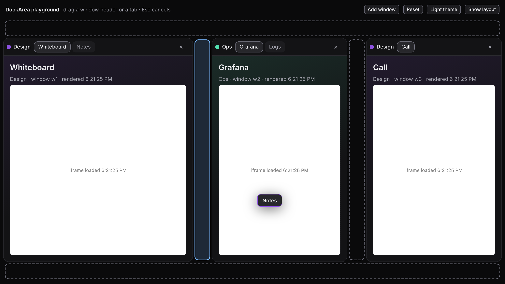
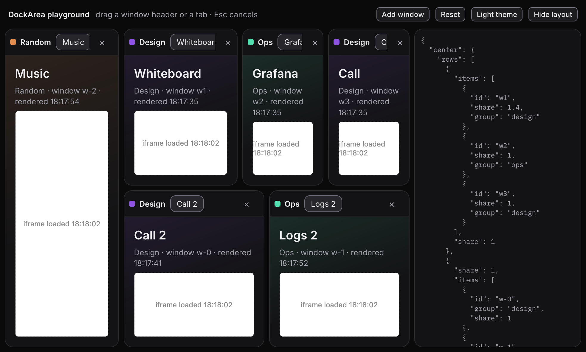

# Dock playground

A standalone page for the `DockArea` (`src/views/dock/`), the layout that arranges the room panels
of the widget host. It uses fake windows of three rooms instead of the app, so drag and drop,
drop targets and splitters can be tried without bindings or a session.

```sh
npm run dock   # from packages/widget-host: http://localhost:5174/
```

- Drag a window by its header to move it, or drop it onto a window of the same room to merge.
- Drag a tab out to make it a window of its own, or drop it onto a window of its room.
- Escape cancels. **Show layout** shows the layout JSON and the last drops.

While dragging, the drop targets near the pointer open up (dashed) and the one a release would
use is highlighted:



